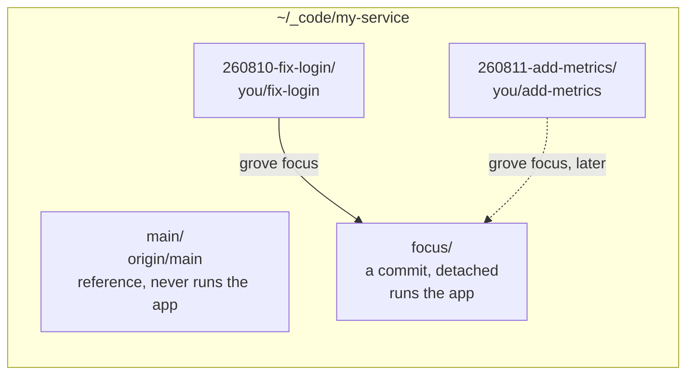
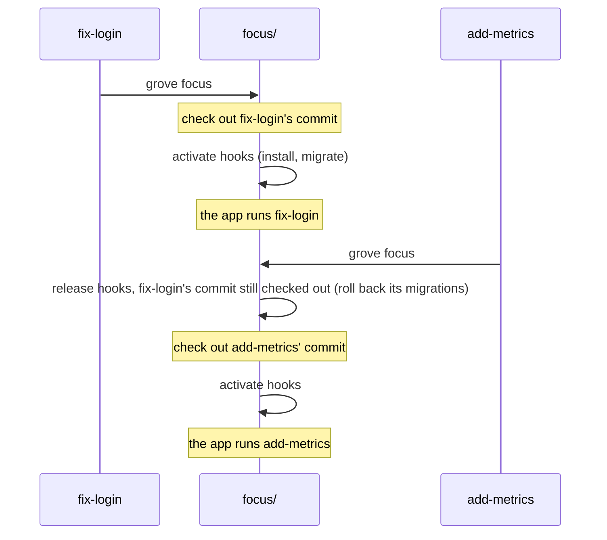

# Focus: one checkout that runs the app

Worktrees let you work on several branches at once. Running several copies of
the app is a different matter. Some apps can only run once per machine: they
bind fixed ports, share one development database, or run one set of background
workers. Start a second copy and it either fails, or quietly shares state with
the first.

Focus is for those repos. You keep writing code and running tests in as many
worktrees as you like, and the app runs in exactly one place: an extra
worktree, `focus/`, that holds whichever worktree's commit you are testing.



- **`main/`** stays a clean reference on the default branch. `grove sync`
  keeps it current, and nothing ever runs from it.
- **Task worktrees** are where code is written and tested.
- **`focus/`** is where the app runs. It is the same directory every time,
  so anything tied to a path (a Docker Compose bind mount, a process manager's
  socket, an editor's run configuration) keeps working when the branch under
  test changes.

## Enable it for a repo

Focus is off until a repo asks for it. Add a `focus` setting to the repo's
[`worktree.json`](worktree-json.md#focus). For a repo whose team does not use
grove, put it in the directory holding `main/`, where it is never committed:

```json
{ "focus": {} }
```

## Focus a worktree

```bash
wt focus                      # inside a worktree: check its HEAD out in focus/
wt focus 260810-fix-login     # or name the worktree
wt focus --watch              # ...and keep following its commits until Ctrl-C
wt focus pull                 # from anywhere: move focus/ to the owner's latest commit
wt focus status               # what is focused, and how far behind it is
wt focus release              # run release hooks; focus/ stays where it is
```

The first `wt focus` creates `focus/`. After that it moves it.

`focus/` is checked out at the worktree's commit, detached, never on its
branch. If two worktrees had the same branch checked out, committing in one
would move the branch under the other, leaving its files out of step with its
HEAD. Detached, `focus/` only ever moves when grove moves it.

Only committed work moves across. `focus` refuses a worktree with uncommitted
changes, and refuses to overwrite changes in `focus/` itself (often files the
app regenerated) unless you pass `--discard`.

## Keeping it up to date

Work flows one way: edit and commit in the worktree, then move `focus/` on.
A running app usually picks up the changed files by itself (Rails' reloader,
a Vite dev server), so there is nothing to restart.

- **`wt focus pull`** moves `focus/` to the owner's latest commit. It works
  from any directory in the repo, including `focus/` itself, and does nothing
  if `focus/` is already there. Uncommitted changes in the worktree stay
  behind, as they always would.
- **`wt focus --watch`** focuses, then pulls each new commit as it lands
  (checking every 2 seconds; change it with `--interval`). Stop it with Ctrl-C
  and it releases the focus worktree. A second Ctrl-C exits without
  releasing. Ctrl-C also interrupts a hook that is running at the time. If another worktree takes `focus/` over meanwhile, the watcher
  stops and leaves it alone. A commit that fails to pull (a hook fails,
  `focus/` has changes) is reported and skipped until the next commit.

Activate hooks run on every pull, so keep them cheap: compare
`GROVE_FOCUS_FROM` and `GROVE_FOCUS_TO` and only install or migrate when the
files that need it changed.

If something does get committed in `focus/`, grove will not move it and
strand those commits on no branch. It stops with `focus_has_commits` and
names the command that brings them to the worktree, usually
`git -C <worktree> merge --ff-only <commit>`. Once the worktree has them,
pulling carries on.

## Handing over

Running an app usually leaves state behind: database migrations, generated
files, caches. Hooks let a repo prepare `focus/` for the incoming commit and
tidy up after the outgoing one.



`release` hooks run before the checkout changes, so they run with the outgoing
code: that code knows how to undo what it did. Refocusing the same worktree
runs only `activate`. `wt focus release` runs `release` and leaves `focus/`
where it is, unowned, so the next focus does not repeat setup for nothing.

See [`worktree.json`](worktree-json.md#focus) for the hook settings and the
environment each hook receives.

## Who has it

`wt focus status` names the worktree that owns `focus/`. The record lives in
the repo's shared git directory, so every worktree sees the same answer. `wt
list` tags the focus worktree and its owner, and `wt cleanup` never offers to
remove the focus worktree, even once it is released.
